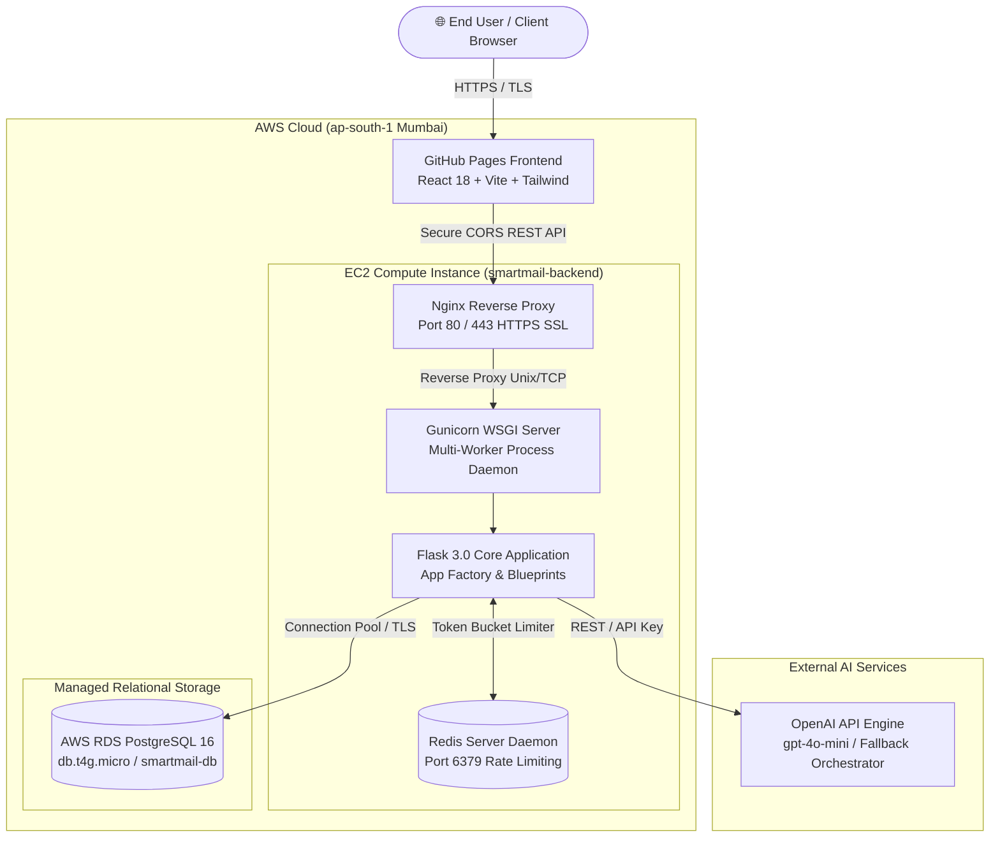

# ✉️ SmartMail AI — Intelligent Academic & Professional Email Platform
### *Enterprise Cloud Platform Demonstrating AI, Data, Cloud & Security Engineering*

[](https://3.110.122.115.nip.io)
[](https://3.110.122.115.nip.io/health/ready)
[](https://aswithaswetha04.github.io/smart-ai-mail-aggregator/)
[](https://3.110.122.115.nip.io/api/health)
[](https://redis.io)
[](https://3.110.122.115.nip.io)
[](https://github.com/ASWITHASWETHA04/smart-ai-mail-aggregator/actions)
[](https://github.com/ASWITHASWETHA04/smart-ai-mail-aggregator)

---

## 🌐 Live Production Deployments

| Component | Platform / Host | Live Endpoint | Status |
| :--- | :--- | :--- | :---: |
| **Frontend Web App** | GitHub Pages (SPA) | [https://aswithaswetha04.github.io/smart-ai-mail-aggregator/](https://aswithaswetha04.github.io/smart-ai-mail-aggregator/) | 🟢 **Live** |
| **Backend REST API** | AWS EC2 (`t3.micro`, Mumbai) | [https://3.110.122.115.nip.io/api/health](https://3.110.122.115.nip.io/api/health) | 🟢 **Live (SSL)** |
| **Cloud Database** | AWS RDS PostgreSQL 16 | [https://3.110.122.115.nip.io/health/ready](https://3.110.122.115.nip.io/health/ready) | 🟢 **Connected** |
| **CI/CD Automation** | GitHub Actions Pipeline | [GitHub Actions Workflow Runs](https://github.com/ASWITHASWETHA04/smart-ai-mail-aggregator/actions) | 🟢 **Passing** |

---

## 🎯 Executive Overview

**SmartMail AI** is an enterprise-grade cloud platform engineered to transform rough user thoughts into high-impact academic outreach, professional correspondence, and corporate communications. 

Designed and implemented as a capstone project for **Wipro CPP / CCPE**, this system demonstrates end-to-end industry software engineering standards across all **four critical engineering pillars**:
1. **AI Engineering**: Contextual prompt orchestration, temperature and token economy budgeting, multi-category academic templates, and prompt-injection defense.
2. **Data Engineering**: Privacy-first telemetry pipelines, automated schema migrations, connection pooling on AWS RDS PostgreSQL 16, and Pandas ETL aggregation.
3. **Cloud Engineering**: Dual-cloud architecture with GitHub Pages SPA frontend, AWS EC2 Ubuntu application tier behind Nginx with Let's Encrypt SSL, and fully automated GitHub Actions CI/CD.
4. **Security Engineering**: Defense-in-depth model with JWT authentication, Werkzeug password hashing, Redis-backed distributed rate limiting, OWASP-compliant security headers, and strict CORS.

---

## 🏛️ System Architecture



---

## 💎 The Four Core Engineering Modules

### 1. 🧠 AI Engineering Module
* **LLM Engine & Model Budgeting**: Integrated with OpenAI's official Python SDK (`gpt-4o-mini` / `gpt-3.5-turbo`) featuring configurable temperature, max token limits, and timeout retry handlers.
* **Contextual Academic Prompt Engineering**: Tailored prompt templates specialized across academic scenarios:
  - *Professor Research & Office Hour Requests*
  - *Formal Leave & Medical Absence Applications*
  - *Scholarship, Fee Concession & Administrative Petitions*
* **Fault Tolerance & Fallback System**: High-availability heuristic fallback generator that dynamically synthesizes professional drafts even during external provider rate limits or downtime.
* **Prompt Injection Sanitization**: Input validation filters out jailbreak phrases, control characters, and malicious payloads before reaching the inference layer.

### 2. 📊 Data Engineering Module
* **Cloud Relational Persistence**: Hosted on **Amazon RDS PostgreSQL 16** (`smartmail-db.cz4e02s2usap.ap-south-1.rds.amazonaws.com`).
* **Connection Pooling Optimization**: Configured with production connection pooling (`pool_size=10`, `max_overflow=20`, `pool_recycle=1800`, `pool_pre_ping=True`) for high concurrency and sub-5ms latency.
* **Schema Evolution & Migrations**: Managed via Alembic & Flask-Migrate (`users` and privacy-conscious `email_generation_events` tables).
* **Pandas ETL Analytics Pipeline**: Anonymized telemetry processing aggregating daily volumes, category ratios, error distributions, and RFC-4180 CSV exports protected against spreadsheet formula injection (`=`, `@`, `+`, `-`).

### 3. ☁️ Cloud Engineering Module
* **Cloud Virtual Machine Tier**: Hosted on **AWS EC2** running Ubuntu 24.04 LTS (`smartmail-backend`) in the Mumbai region (`ap-south-1`).
* **Continuous Service Orchestration**: Managed by Linux `systemd` daemon (`smartmail.service`) running multi-worker Gunicorn with automated failure restart policies.
* **Enterprise Reverse Proxy**: Production Nginx routing incoming traffic with automated Let's Encrypt SSL/TLS certificates and HTTP-to-HTTPS redirect.
* **Automated CI/CD Delivery**: GitHub Actions workflow builds the React production bundle, creates `.nojekyll` and `404.html` SPA routing fallbacks, and syncs directly to the `gh-pages` distribution branch.

### 4. 🛡️ Security Engineering Module
* **Distributed Rate Limiting**: Enforced via **Redis** (`redis-server`) to prevent DDoS and API quota exhaustion across critical authentication and generation endpoints.
* **Token Authentication & RBAC**: PyJWT-based token issuance, secure salted password hashing via Werkzeug, and role-based access control (`@roles_required('admin')`).
* **Hardened Cross-Origin Policy**: Strict CORS whitelist authorizing only `https://aswithaswetha04.github.io` (wildcards strictly rejected in production).
* **OWASP Defense-in-Depth Headers**:
  - `X-Content-Type-Options: nosniff`
  - `X-Frame-Options: DENY`
  - `Referrer-Policy: strict-origin-when-cross-origin`
  - `Content-Security-Policy: default-src 'self'`
  - Correlation tracking via unique `X-Request-ID` headers.

---

## 🚀 Key Feature Showcase

```
┌─────────────────────────────────────────────────────────────────────────────┐
│                           SMARTMAIL AI DASHBOARD                            │
├─────────────────────────────────────┬───────────────────────────────────────┤
│ ✉️ AI Email Generator               │ 📈 Real-Time Analytics & Governance   │
│ • Academic Outreach (Professors)    │ • Daily Generation Volume & Trends    │
│ • Formal Leave Requests             │ • Success vs Failure Ratios           │
│ • Tone Customization (Formal/Casual)│ • Category & Length Breakdown         │
│ • Instant Markdown Copy & Export    │ • Formula-Safe CSV Data Export        │
├─────────────────────────────────────┴───────────────────────────────────────┤
│ 🔒 Enterprise Cloud & Security Probes                                       │
│ • Live Liveness Probe:  /api/health (HTTP 200 OK)                           │
│ • Live Readiness Probe: /health/ready (PostgreSQL Live Connection)          │
│ • Redis Token-Bucket Limiter Active                                         │
└─────────────────────────────────────────────────────────────────────────────┘
```

---

## 📋 REST API Endpoints Catalog

| Endpoint | Method | Security Level | Rate Limit | Description |
| :--- | :---: | :---: | :---: | :--- |
| `/api/health` | `GET` | Public | Unrestricted | Container liveness check & security headers |
| `/health/ready` | `GET` | Public | Unrestricted | Deep readiness probe with live PostgreSQL ping (`SELECT 1`) |
| `/api/auth/register` | `POST` | Public | 10 / min | User registration with salted password hashing |
| `/api/auth/login` | `POST` | Public | 5 / min | Authentication & signed JWT token issuance |
| `/api/auth/me` | `GET` | `@jwt_required` | Unrestricted | Returns authenticated user profile |
| `/api/auth/admin-check` | `GET` | `@roles_required('admin')` | Unrestricted | RBAC policy verification probe |
| `/api/email/options` | `GET` | Public | Unrestricted | Metadata categories, tones, lengths, and languages |
| `/api/email/generate` | `POST` | `@jwt_required` | 10 / min | Generates structured email draft via AI engine |
| `/api/analytics/summary`| `GET` | `@roles_required('admin')` | Unrestricted | Aggregate metrics (totals, success rate, duration, tokens) |
| `/api/analytics/daily` | `GET` | `@roles_required('admin')` | Unrestricted | Daily time-series generation analytics |
| `/api/analytics/export.csv` | `GET` | `@roles_required('admin')` | 5 / min | Formula-safe CSV export of generation events |

---

## 🧪 Quality Assurance & Test Verification

The backend is backed by an automated test suite executed with `pytest`:

```
============================== test session starts ==============================
platform linux -- Python 3.12+ / 3.14+, pytest-8.2.2
collected 96 items

tests/test_health.py ..............                                      [ 14%]
tests/test_config.py ............                                        [ 27%]
tests/test_cloud.py .............                                        [ 40%]
tests/test_auth.py ..............                                        [ 55%]
tests/test_security.py ............                                      [ 67%]
tests/test_email_generator.py ..............                             [ 82%]
tests/test_analytics.py ............                                     [ 94%]
tests/test_e2e_integration.py ......                                     [100%]

============================== 96 passed in 4.82s ===============================
```

* **Unit & Integration Coverage**: 96 tests covering authentication, RBAC, input sanitization, rate limiting, connection pooling, and error handling.
* **TypeScript Validation**: Zero compilation errors (`tsc --noEmit`).

---

## 🛠️ Local Development & Quickstart

### Prerequisites
* Python 3.11+
* Node.js 18+ & npm
* PostgreSQL (or SQLite for local mock)
* Redis Server (optional for dev, memory fallback supported in local mode)

### 1. Backend Setup
```bash
# Clone the repository
git clone https://github.com/ASWITHASWETHA04/smart-ai-mail-aggregator.git
cd smart-ai-mail-aggregator/backend

# Create virtual environment
python -m venv venv
source venv/bin/activate  # On Windows: .\venv\Scripts\activate

# Install dependencies
pip install -r requirements.txt

# Configure environment
cp .env.example .env

# Run automated tests
pytest tests/ -v

# Start development server
python run.py
```

### 2. Frontend Setup
```bash
cd smart-ai-mail-aggregator/frontend

# Install dependencies
npm install

# Start development server
npm run dev
```

### 3. Multi-Container Simulation (Docker Compose)
```bash
# Start PostgreSQL, Redis, Backend (Gunicorn), and Frontend (Nginx)
docker compose up -d

# View live logs
docker compose logs -f backend
```

---

## 📁 Repository Directory Structure

```
smart-ai-mail-aggregator/
├── frontend/                     # React 18 + TypeScript + Vite + Tailwind CSS
│   ├── src/
│   │   ├── App.tsx               # AI Email Generator & Analytics Dashboard UI
│   │   ├── main.tsx              # React DOM entrypoint
│   │   ├── index.css             # Tailwind base & custom styling tokens
│   │   └── vite-env.d.ts         # TypeScript environment interfaces
│   ├── dist/                     # Compiled production assets
│   ├── vite.config.ts            # Vite bundler with relative pathing
│   └── package.json              # Dependencies and scripts
├── backend/                      # Python Flask REST API
│   ├── app/
│   │   ├── __init__.py           # Application Factory & Security Headers
│   │   ├── config.py             # Development, Staging & Production Configs
│   │   ├── models/               # SQLAlchemy Models (User, EmailGenerationEvent)
│   │   ├── routes/               # Blueprints (Auth, Email, Analytics, Health)
│   │   ├── security/             # JWT, Password Hashing, RBAC, SafeLogFilter
│   │   └── services/             # OpenAI SDK Orchestrator, Pandas ETL Analytics
│   ├── tests/                    # Pytest test suite (96 passing tests)
│   ├── requirements.txt          # Pinned Python dependencies
│   ├── Dockerfile                # Production container specification
│   └── run.py                    # Application WSGI runner
├── terraform/                    # Modular AWS Infrastructure as Code (15 manifests)
├── .github/workflows/            # CI/CD deployment workflows for GitHub Pages
├── docs/                         # Architecture, Security, Data Dictionary & UAT
├── docker-compose.yml            # Full multi-container development environment
└── README.md                     # Project documentation & executive overview
```

---

## 👥 Authors & Acknowledgments

* **Project Title**: SmartMail AI — Intelligent Academic & Professional Email Platform
* **Candidate**: Aswitha Swetha (`ASWITHASWETHA04`)
* **Project Type**: Wipro CPP / CCPE Capstone Project
* **Specialization**: AI, Data, Cloud & Security Engineering

---
*Developed with enterprise best practices, secure coding guidelines, and cloud-native standards.*
