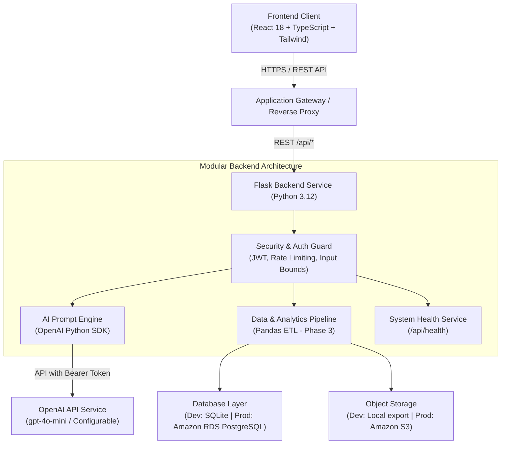

# SmartMail AI — System Architecture Specification

## 1. Executive Overview
SmartMail AI is an enterprise-grade academic and professional email generation platform engineered across four core domains:
1. **AI Engineering**: Context-driven prompt engineering, structured JSON outputs, OpenAI Python SDK integration, defensive input sanitization, and model agility.
2. **Data Engineering**: Privacy-preserving event capture, Pandas analytics pipelines, tone/engagement metrics, and aggregated reporting.
3. **Cloud Engineering**: Containerized microservices, AWS target infrastructure (ECS/App Runner, S3, RDS PostgreSQL), and automated CI/CD.
4. **Security Engineering**: Defense-in-depth model including JWT authentication, Werkzeug salted password hashing, Flask-Limiter rate limiting, and defensive HTTP security headers.

---

## 2. High-Level Component Diagram



---

## 3. Technology Stack & Decision Matrix

| Layer | Selected Technology | Version | Architectural Rationale |
| :--- | :--- | :--- | :--- |
| **Frontend Framework** | React + TypeScript | React 18, TS 5.4 | Strict type-safety, component reusability, seamless state management. |
| **Frontend Build Tool** | Vite | 5.3+ | Fast HMR, optimized ESM production builds. |
| **Styling** | Tailwind CSS | 3.4+ | Utility-first, responsive, accessible, token-based design system. |
| **Backend Framework** | Python / Flask | Flask 3.0.3, Python 3.12 | Lightweight, modular application factory, fast REST response cycles. |
| **AI Integration** | Official OpenAI SDK | openai==1.35.13 | Direct API control, configurable models, timeout/retry bounds, JSON mode. |
| **Local Database** | SQLite 3 | Embedded | Zero-dependency local persistence for fast iterative testing. |
| **Production Database** | PostgreSQL on Amazon RDS | 15+ | ACID compliance, concurrent connection pooling, managed backups. |
| **Security Controls** | Flask-Limiter, PyJWT, Werkzeug | Latest pinned | Token-based stateless authentication, brute force protection, OWASP alignment. |

---

## 4. Engineering Module Details

### 4.1 AI Engineering (Phase 2 Implemented)
- **Official SDK Client**: `openai.OpenAI(api_key=..., timeout=30, max_retries=2)`.
- **Model Agility**: Configured through server-side `OPENAI_MODEL` environment variable (defaults to `gpt-4o-mini`).
- **Defensive Prompt Architecture**:
  - Strict instruction isolation: System prompt specifies output rules and forbids role overriding.
  - User context delimited with triple quotes (`"""..."""`) and treated as untrusted text.
  - Bracketed placeholder policy (e.g. `[Recipient Name]`, `[Your Name]`) for unsupplied facts.
- **Structured Output**: Model outputs strict JSON schema `{ "subject": "...", "body": "..." }`, validated and normalized before serialization.
- **Supported Options**:
  - 13 Categories: Academic communication, Professional inquiry, Job application, Internship application, Follow-up, Meeting request, Meeting confirmation, Thank-you email, Apology, Complaint or issue resolution, Leave request, Business proposal, General professional email.
  - 7 Tones: Professional, Formal, Friendly, Polite, Persuasive, Apologetic, Concise.
  - 3 Lengths: Short (50–100 words), Medium (120–220 words), Detailed (230–400 words).
  - 8 Languages: English, Spanish, French, German, Chinese, Hindi, Japanese, Portuguese.

### 4.2 Data Engineering (Phase 3 Implemented & Verified)
- **Privacy-Conscious Telemetry**: Schema-level privacy enforcement (`EmailGenerationEvent`). Full email bodies, prompt contents, recipient details, and credentials are never stored.
- **Persistent Event Collection**: Automatically captures generation outcomes (`generation_succeeded`, `generation_failed`), category, tone, language, length, roundtrip duration (`duration_ms`), validated provider token counts, and sanitized error categories.
- **Repeatable Pandas 2.2.2 ETL**:
  - `extract_events`: Bounded database extraction with parameterized date filters (`start_date`, `end_date`), category filters, and safety query limits.
  - `transform_events`: Pure, deterministic aggregation yielding daily generation volume, success rates, latency averages/medians, token sums/averages, and categorical distributions (category, tone, language, failure error codes) with robust null and zero-denominator handling.
  - `generate_aggregate_csv`: RFC-4180 aggregate CSV generation with spreadsheet formula injection protection (escaping leading `=`, `+`, `-`, `@`).
- **Analytics APIs & RBAC**:
  - `GET /api/analytics/summary`
  - `GET /api/analytics/daily`
  - `GET /api/analytics/distributions`
  - `GET /api/analytics/export.csv`
  - Strictly protected by `@jwt_required` and `@roles_required('admin')`.
- **Frontend Analytics Dashboard**: Interactive dashboard in React/TypeScript featuring real-time KPI cards, time-series tables, distribution progress meters, date-range filters, and CSV export.

### 4.3 Cloud Engineering (Phase 4 Implemented & Verified)
- **Containerization**:
  - Backend: Pinned `python:3.12-slim` image, non-root user `appuser` (UID 10001), production WSGI server (`Gunicorn` with 2 workers, 4 threads, 60s timeout), healthcheck probe on `/api/health`.
  - Frontend: Multi-stage build (`node:20-alpine` builder, `nginx:1.27-alpine` runtime) with SPA routing fallback (`try_files $uri $uri/ /index.html;`) and security headers.
  - Local Orchestration: `docker-compose.yml` supporting local backend, frontend, PostgreSQL 16, and Redis 7 containers.
- **Production Database & Migrations**:
  - PostgreSQL 16 on Amazon RDS in private database subnets with storage encryption (`AES-256`) and automated backups.
  - SQLAlchemy connection pooling: `pool_size=10`, `max_overflow=20`, `pool_timeout=30`, `pool_recycle=1800`, `pool_pre_ping=True`.
  - Alembic / Flask-Migrate database migrations (`001_initial_schema.py`) decoupled from container startup (`AUTO_CREATE_TABLES=False` in production).
- **Shared Rate Limiting with Redis**:
  - Flask-Limiter configured with Redis backend (`RATELIMIT_STORAGE_URI=redis://...` or `rediss://...`) on Amazon ElastiCache.
  - Fail-safe startup validation strictly prohibits silent fallback to per-process in-memory limits in production.
- **Secrets Management**:
  - Centralized runtime secret storage in AWS Secrets Manager (`smartmail-ai/production/credentials`).
  - Injected directly into ECS Fargate containers via task execution role with least-privilege IAM policies.
- **Infrastructure as Code (Terraform)**:
  - 14 modular Terraform manifests defining VPC, subnets, security groups, RDS, ElastiCache, ALB, ECS Fargate, ECR, S3, CloudFront, Secrets Manager, and CloudWatch.
- **CI/CD Pipeline**:
  - Automated GitHub Actions workflow (`.github/workflows/ci-cd.yml`) covering backend tests, frontend lint/build, Terraform validation, Docker build, and gated OIDC deployment.
- **Observability & Health Probes**:
  - Dual probes: Liveness (`GET /api/health`) for container process state; Readiness (`GET /api/ready`) with live database connectivity verification (`SELECT 1`).
  - Distributed request correlation tracing via `X-Request-ID` and CloudWatch structured logging.

### 4.4 Security Engineering (Phase 1 & Phase 4 Implemented)
- **Credential Isolation**: Zero hardcoded secrets; environment variable loading via `.env` with `.env.example` validation; AWS Secrets Manager for production.
- **Network Boundaries**: 3-tier VPC architecture (Public, Private Application, Isolated Database); security groups enforce strict least-privilege ingress.
- **Rate Limiting**: Distributed Redis storage (5/min login, 10/min register, 10/min email generation).
- **Security Headers & CSP**: HSTS, X-Content-Type-Options: nosniff, X-Frame-Options: DENY, Referrer-Policy, Content-Security-Policy.

---

## 5. Target AWS Cloud Architecture

```mermaid
graph TD
    User["Web Browser / Client"] -->|HTTPS / Port 443| CF["Amazon CloudFront CDN\n(Edge Locations / TLS 1.3)"]
    User -->|HTTPS API Requests| ALB["Application Load Balancer\n(Public Subnets / TLS ACM)"]

    subgraph AWS_Cloud ["AWS Cloud (Region: us-east-1)"]
        subgraph Edge_Storage ["Static Frontend Tier"]
            CF -->|Origin Access Control (OAC)| S3["Amazon S3 Static Bucket\n(React SPA Assets)"]
        end

        subgraph VPC ["Dedicated VPC (10.0.0.0/16)"]
            subgraph Public_Subnets ["Public Subnets (10.0.1.0/24, 10.0.2.0/24)"]
                ALB
                NAT["NAT Gateway\n(Outbound HTTPS Egress)"]
            end

            subgraph Private_Subnets ["Private Application Subnets (10.0.10.0/24, 10.0.11.0/24)"]
                ALB -->|Forward :5000\nHealth: /api/health| ECS["Amazon ECS Fargate Cluster\n(smartmail-ai-backend containers)"]
                ECS -->|Outbound HTTPS via NAT| NAT
            end

            subgraph Database_Subnets ["Isolated Database Subnets (10.0.20.0/24, 10.0.21.0/24)"]
                ECS -->|Port 5432\nTLS Encrypted| RDS["Amazon RDS PostgreSQL 16\n(Multi-AZ / Encrypted gp3)"]
                ECS -->|Port 6379\nIn-VPC Only| Redis["Amazon ElastiCache Redis 7\n(Shared Rate Limit Store)"]
            end
        end

        subgraph AWS_Managed_Services ["Managed AWS Cloud Services"]
            ECR["Amazon ECR\n(Vulnerability Scanned Images)"] -.->|Pull Image| ECS
            Secrets["AWS Secrets Manager\n(JWT, DB Pass, API Keys)"] -.->|Inject at Startup| ECS
            CW["Amazon CloudWatch\n(Logs, Metrics & Alarms)"] <--- ECS
            NAT -->|Egress HTTPS :443| OpenAI["OpenAI API Service\n(gpt-4o-mini)"]
        end
    end
```

---

## 6. End-to-End Request Flow

1. **Frontend Static Request**:
   - The user's browser requests `https://<domain>/`.
   - Request hits CloudFront edge cache. If cache miss, CloudFront fetches assets from private Amazon S3 bucket via Origin Access Control (OAC).
   - If a client-side route is navigated directly (e.g. `/analytics`), CloudFront custom error response rewrites 403/404 to `/index.html` with status 200, enabling clean client-side routing.

2. **API Request Flow**:
   - Frontend triggers API call `POST /api/generate` with JWT bearer token.
   - Request terminates TLS at Application Load Balancer (ALB).
   - ALB forwards traffic over private VPC network to healthy ECS Fargate tasks on container port 5000.
   - Gunicorn worker receives request, extracts or generates `X-Request-ID` correlation ID, and invokes Flask application.

3. **Rate Limiting & Authentication**:
   - Flask-Limiter contacts ElastiCache Redis over private VPC port 6379 to increment request count for client IP.
   - If limit exceeded, returns 429 Too Many Requests immediately.
   - JWT utility validates signature using `JWT_SECRET_KEY` fetched from Secrets Manager.

4. **AI Generation & Telemetry**:
   - Flask backend formats prompt and calls OpenAI API over outbound HTTPS (routed via VPC NAT Gateway).
   - Upon completion, operational metadata (category, latency, tokens) is inserted into RDS PostgreSQL over port 5432 using SQLAlchemy connection pool.
   - Sanitized JSON response returned to frontend; structured log entry emitted to CloudWatch.

