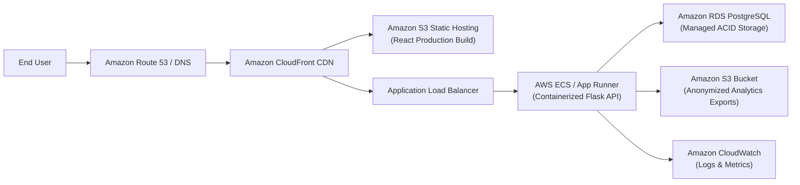

# SmartMail AI — Cloud Deployment Plan

## 1. Cloud Architecture Strategy
SmartMail AI is designed for containerized deployment with cloud-native scalability while maintaining budget awareness.

### Target Cloud Environment: Amazon Web Services (AWS)



---

## 2. Infrastructure Components

| AWS Service | Role in SmartMail AI | Phase 4 Deliverable |
| :--- | :--- | :--- |
| **AWS App Runner / ECS Fargate** | Serverless container runtime for Flask backend | Container execution with auto-scaling based on HTTP concurrency. |
| **Amazon S3** | Static web hosting & exported analytics datasets | S3 bucket configurations with private ACLs and encryption at rest. |
| **Amazon CloudFront** | Global Content Delivery Network with HTTPS | TLS certificate termination and edge caching for frontend static assets. |
| **Amazon RDS PostgreSQL** | Managed relational database | Multi-AZ ready PostgreSQL instance replacing local development SQLite. |
| **AWS CloudWatch** | Centralized structured logging & alarms | Alarms on 5xx error spikes, container health checks, and latency anomalies. |
| **AWS Secrets Manager** | Secure secret distribution | Server-side runtime injection of `OPENAI_API_KEY` and database credentials. |

---

## 3. Local Development vs. Production Mapping

| Aspect | Local Development (Phases 0-3) | Production (Phase 4 Target) |
| :--- | :--- | :--- |
| **Backend Runtime** | Python 3.12 (`backend/run.py` dev server) | Docker container running Gunicorn WSGI |
| **Frontend Runtime** | Vite Dev Server (`localhost:5173`) | Nginx container or S3/CloudFront static site |
| **Database** | SQLite (`smartmail.db`) | Amazon RDS PostgreSQL |
| **Secret Management** | Local `.env` file (git-ignored) | AWS Secrets Manager / Parameter Store |
| **File Storage** | Local directory exports | Amazon S3 Bucket |
| **Networking** | Localhost CORS | Restricted CORS behind CloudFront / ALB domain |

---

## 4. Production Containerization & Local Simulation

### 4.1 Backend Container
- Base Image: `python:3.12-slim`
- Security: Non-root execution (`appuser`, UID `10001`)
- WSGI Server: `gunicorn --bind 0.0.0.0:5000 --workers 2 --threads 4 --timeout 60 run:app`
- Healthcheck: HTTP probe on `http://127.0.0.1:5000/api/health`

### 4.2 Frontend Container
- Multi-Stage: `node:20-alpine` builder, `nginx:1.27-alpine` runner
- Web Server: Nginx with SPA routing fallback (`try_files $uri $uri/ /index.html;`) and security response headers.

### 4.3 Local Multi-Service Simulation (Docker Compose)
To run the full stack locally with PostgreSQL and Redis (where Docker is installed):
```bash
# Start all 4 services: PostgreSQL 16, Redis 7, Backend (Gunicorn), Frontend (Nginx)
docker compose up -d

# Inspect live container logs
docker compose logs -f backend

# Stop containers without losing database volume
docker compose down

# Stop and wipe persistent development volumes
docker compose down -v
```

---

## 5. Database Migration & Baseline Adoption Runbook

SmartMail AI uses **Flask-Migrate** and **Alembic** for schema migrations.

### 5.1 Local Development Workflow
```bash
# Check current migration revision
& "backend\venv\Scripts\flask" db current -d backend/migrations

# Create a new schema migration script after modifying models
& "backend\venv\Scripts\flask" db migrate -d backend/migrations -m "description_of_change"

# Upgrade database to latest revision
& "backend\venv\Scripts\flask" db upgrade -d backend/migrations
```

### 5.2 Adoption for Existing Databases Created by `db.create_all()`
If deploying against an existing database that already contains `users` and `email_generation_events` tables:
```bash
# Stamp the database at head without re-running CREATE TABLE statements:
flask db stamp head -d backend/migrations
```

### 5.3 Production Migration Policy
- **Never Run Migrations Automatically in Application Workers**: `AUTO_CREATE_TABLES` is `False` in `ProductionConfig`.
- **Run as a Controlled Deployment Step**: Execute `flask db upgrade` in a one-off ECS task or CI/CD migration job before flipping traffic to newly deployed container images.
- **Backup Verification**: Always take an automated snapshot of RDS (`aws rds create-db-snapshot`) before running destructive or altering schema changes.

---

## 6. AWS Infrastructure as Code (Terraform) Runbook

All AWS resources are declared in modular Terraform manifests under `terraform/`.

### 6.1 Prerequisites
1. AWS CLI installed and configured with credentials or SSO.
2. Terraform CLI (>= 1.5) installed.

### 6.2 Staging vs. Production Step-by-Step Provisioning

#### Staging Environment (Cost-Optimized & Isolated)
```bash
cd terraform

# 1. Initialize providers without backend lock
terraform init -backend=false

# 2. Validate syntax and configuration
terraform fmt -check
terraform validate

# 3. Create execution plan for staging (using canonical local staging tfvars file)
# Note: Copy terraform.staging.tfvars.example to terraform.staging.tfvars and populate with local staging parameters
terraform plan -var-file="terraform.staging.tfvars" -out="staging.tfplan"

# 4. Apply changes (requires explicit human authorization)
terraform apply "staging.tfplan"
```

#### Production Environment (High Availability)
```bash
cd terraform

# 1. Initialize providers
terraform init

# 2. Validate syntax and configuration
terraform fmt -check
terraform validate

# 3. Create execution plan for production
terraform plan -var-file="terraform.tfvars" -out="prod.tfplan"

# 4. Apply changes (requires explicit human approval gate)
terraform apply "prod.tfplan"
```

### 6.3 Cost Analysis & Budget Safeguards
- **RDS PostgreSQL**: Configured on Graviton2 `db.t4g.micro` (Single-AZ, ~$15.00/month).
- **ElastiCache Redis**: Single-node `cache.t4g.micro` (~$11.50/month).
- **NAT Gateway**: Single cost-optimized NAT gateway in Public Subnet 1 (~$32.40/month + data transfer).
- **ECS Fargate**: 2 tasks @ 0.25 vCPU / 0.5 GB RAM (~$14.60/month).
- **Application Load Balancer**: 1 ALB, 2 AZs (~$22.50/month).
- **CloudWatch & Secrets Manager**: Audit logging, 6 alarms, encrypted secret (~$4.95/month).
- **Total Estimated Baseline AWS Cost**: ~$101.95/month for dedicated multi-tier VPC environment.
- *Staging Cost Optimization*: In staging, setting `desired_count = 1` and `log_retention_days = 7` reduces monthly compute and logging overhead.

### 6.4 Resource Cleanup for Disposable Environments
```bash
cd terraform

# Destroy all disposable staging cloud infrastructure
terraform destroy -var-file="terraform.staging.tfvars"
```
*Note*: If deletion protection is enabled on RDS, ensure `enable_deletion_protection = false` in `terraform.staging.tfvars` before destroying.

---

## 7. CI/CD Pipeline & Zero-Downtime Deployment

### 7.1 GitHub Actions Workflow (`.github/workflows/ci-cd.yml`)
The workflow operates across six staged jobs:
1. `backend-test`: Executes full pytest test suite (97 tests) on Python 3.12, including CI/CD safety assertion checks.
2. `frontend-build`: Executes TypeScript verification (`tsc --noEmit`) and Vite production bundle check.
3. `terraform-validate`: Formats and statically validates all HCL manifests.
4. `docker-validate`: Builds Docker images for backend and frontend.
5. `deploy-staging`: Explicit opt-in manual workflow dispatch (`deploy_to_staging=true`) via GitHub OIDC to Amazon ECR, ECS Fargate staging service, and staging S3 bucket with strict `VITE_API_BASE_URL` validation.
6. `deploy-production`: Gated production deployment requiring explicit manual dispatch approval (`deploy_to_production=true`) and strict `VITE_API_BASE_URL` validation.

### 7.2 Rollback Procedure
If an issue occurs after deploying a new release:
1. **ECS Backend Rollback**:
   ```bash
   # Revert ECS service to previous task definition revision
   aws ecs update-service \
     --cluster smartmail-ai-staging-cluster \
     --service smartmail-ai-staging-service \
     --task-definition smartmail-ai-staging-task:<previous_revision> \
     --force-new-deployment
   ```
2. **Frontend Rollback**:
   Sync previous build from versioned S3 bucket or re-trigger GitHub Actions release workflow for the prior Git commit tag.
3. **Database Migration Incompatibility Handling**:
   - If the new database migration added non-breaking additive columns/indexes, the previous application revision continues running without rollback.
   - If the migration made breaking structural changes, roll forward with an emergency patch migration or restore RDS from the pre-deployment automated snapshot taken via `aws rds restore-db-instance-to-point-in-time`.


