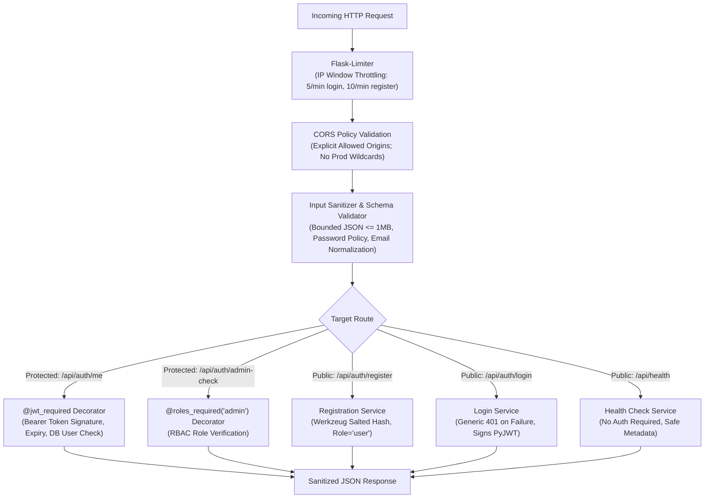

# SmartMail AI — Security Plan & Engineering Controls

## 1. Security Philosophy & Principles
SmartMail AI adopts a strict defense-in-depth approach adhering to OWASP API Security Top 10 and secure software engineering principles:
1. **Never Commit Secrets**: Zero hardcoded credentials; strict `.gitignore` rules and automated git tracking checks.
2. **Principle of Least Privilege**: Distinct roles (`admin`, `user`) with fine-grained access control on sensitive routes. Public registration cannot self-assign privileged roles.
3. **Defense Against Prompt Injection**: Input sanitization, delimiters, length caps, and system instructions preventing adversarial role subversion (Phase 2).
4. **Safe Error Handling**: Never leak internal file paths, stack traces, database schema details, or environment variables in responses.
5. **Defense Against Abuse**: Rate limiting on sensitive endpoints (auth, email generation, export).

---

## 2. Implemented Security Architecture (Phase 1 Baseline)

---

## 3. Authentication & Authorization Specifications

### 3.1 Endpoints Catalog

| Endpoint | Method | Rate Limit | Auth Required | Expected Request | Success Response | Error Responses |
| :--- | :---: | :---: | :---: | :--- | :--- | :--- |
| `/api/health` | GET | Default (100/hr) | None | None | 200 OK: `{status, service, version, environment}` | 405 Method Not Allowed |
| `/api/auth/register` | POST | 10 per min | None | JSON: `{email, password}` | 201 Created: `{message, user: {id, email, role, created_at}}` | 400 (Validation / Malformed), 409 (Duplicate Email), 413 (Payload > 1MB) |
| `/api/auth/login` | POST | 5 per min | None | JSON: `{email, password}` | 200 OK: `{message, access_token, token_type: 'Bearer', expires_in: 3600, user}` | 400 (Missing fields), 401 (Invalid credentials), 429 (Rate limit exceeded) |
| `/api/auth/me` | GET | Default | Bearer JWT | Header: `Authorization: Bearer <token>` | 200 OK: `{user: {id, email, role, created_at, last_login_at}}` | 401 (Missing, malformed, expired, or tampered token) |
| `/api/auth/admin-check` | GET | Default | Bearer JWT (`admin`) | Header: `Authorization: Bearer <token>` | 200 OK: `{message: 'Admin authorization verified.', user}` | 401 (Unauthorized), 403 (Forbidden: insufficient permissions) |
| `/api/email/options` | GET | Default | None | None | 200 OK: `{categories, tones, lengths, languages}` | None |
| `/api/email/generate` | POST | 10 per min | Bearer JWT | JSON: `{purpose, category, tone, ...}` | 200 OK: `{message, draft}` | 400 (Validation), 401 (Unauthorized), 429, 502, 503, 504 |
| `/api/analytics/summary` | GET | Default | Bearer JWT (`admin`) | Query: `start_date`, `end_date`, `category` | 200 OK: `{status, filters, is_empty, summary}` | 400 (Invalid range), 401 (Unauthorized), 403 (Forbidden) |
| `/api/analytics/daily` | GET | Default | Bearer JWT (`admin`) | Query: `start_date`, `end_date`, `category` | 200 OK: `{status, filters, is_empty, daily_activity}` | 400 (Invalid range), 401 (Unauthorized), 403 (Forbidden) |
| `/api/analytics/distributions` | GET | Default | Bearer JWT (`admin`) | Query: `start_date`, `end_date`, `category` | 200 OK: `{status, filters, is_empty, distributions}` | 400 (Invalid range), 401 (Unauthorized), 403 (Forbidden) |
| `/api/analytics/export.csv` | GET | Default | Bearer JWT (`admin`) | Query: `start_date`, `end_date`, `category` | 200 OK: RFC-4180 CSV attachment | 400 (Invalid range), 401 (Unauthorized), 403 (Forbidden) |

### 3.2 Password Hashing & Policy
- **Hashing**: Werkzeug secure password hashing (`generate_password_hash`), utilizing salted key derivation (scrypt / PBKDF2-HMAC-SHA256).
- **Policy**:
  - Minimum length: 8 characters.
  - Maximum length: 128 characters.
  - Required characters: At least one letter and at least one numerical digit.
- **Leakage Prevention**: Plaintext passwords and password hashes are never serialized in responses, stored in sessions, or printed in logs.

### 3.3 JWT Token Claims & Verification
- **Algorithm**: `HS256` (HMAC with SHA-256) with configurable secret key (`JWT_SECRET_KEY`).
- **Standard Claims**:
  - `sub`: User UUID (`users.id`).
  - `email`: Normalized user email.
  - `role`: User role (`user` or `admin`).
  - `iat`: Timestamp issued (UTC).
  - `exp`: Timestamp expiration (UTC, default 60 minutes).
- **Validation**: Signature integrity, expiration timestamp, and required claims are strictly enforced on every protected call.

---

## 4. HTTP Security Headers & Defense Controls

All responses emitted by the Flask backend include defensive HTTP response headers:
- `X-Content-Type-Options: nosniff`: Prevents MIME-type sniffing.
- `X-Frame-Options: DENY`: Mitigates clickjacking attacks.
- `Referrer-Policy: strict-origin-when-cross-origin`: Restricts referrer information leakage.
- `Content-Security-Policy: default-src 'self'; frame-ancestors 'none';`: Restricts unauthorized script and frame embeddings.

---

## 5. Safe Logging & Data Privacy Policy

The logging subsystem utilizes a custom filter (`SafeLogFilter`) that automatically scrubs sensitive credentials from log streams:
- **Redacted Fields**: Bearer tokens (`[REDACTED_TOKEN]`), passwords (`[REDACTED_PASSWORD]`), secrets (`[REDACTED_SECRET]`), signing keys (`[REDACTED_KEY]`), and API keys (`[REDACTED_API_KEY]`).
- **Authorization Headers**: Never logged in access or debug logs.
- **Database Exceptions**: Unhandled database exceptions are intercepted and converted to a safe generic HTTP 500 response without leaking table schemas, paths, or connection strings.

---

## 6. Threat Modeling & Verification Matrix

| Threat Vector | Severity | Target Component | Engineered Mitigation | Verification Test |
| :--- | :---: | :--- | :--- | :--- |
| **API Key / Secret Exposure** | Critical | Backend Config | Production startup halts if `SECRET_KEY` or `JWT_SECRET_KEY` is missing or default. | `test_config.py` |
| **Token Tampering / Forgery** | High | Auth Decorators | Tampered signature or invalid secret rejected with 401. | `test_security.py` |
| **Token Expiration Bypass** | High | Auth Decorators | Expired tokens rejected with 401. | `test_security.py` |
| **Brute Force Credential Guessing** | High | `/api/auth/login` | Flask-Limiter enforces 5 requests/minute threshold; returns 429. | `test_security.py` |
| **Privilege Escalation** | High | `/api/auth/register` | Rejects payload if `role` is supplied with privileged value (e.g. `admin`). | `test_auth.py` |
| **Role Authorization Bypass** | High | Admin Endpoints | `@roles_required('admin')` returns 403 Forbidden for regular users. | `test_auth.py` |
| **Denial of Service via Payload** | Medium | Request Parser | `MAX_CONTENT_LENGTH = 1MB` returns 413 Payload Too Large. | `test_security.py` |
| **Malformed JSON Exploits** | Medium | Request Parser | Syntax errors return clean 400 Bad Request. | `test_security.py` |
| **Information Leakage via Errors** | Medium | Error Handlers | Generic 500 response masks internal tracebacks and connection strings. | `test_security.py` |
| **CSV Formula Injection** | Medium | Analytics Export | Sanitizer (`sanitize_csv_cell`) escapes leading `=`, `+`, `-`, `@` with single quote `'`. | `test_analytics.py` |
| **Cross-User Telemetry Exposure** | High | Analytics Endpoints | Role verification (`@roles_required('admin')`) restricts analytics and export to admins. | `test_analytics.py` |
| **Distributed Rate Limiting Bypass** | High | Multi-task Backend | `ProductionConfig` strictly mandates Redis storage (`RATELIMIT_STORAGE_URI`); prohibits in-memory fallback. | `test_cloud.py` |
| **Database Public Exposure** | Critical | RDS & Redis | Database & Redis deployed strictly in isolated private subnets with no internet routes. | Terraform security group rules |
| **Container Privilege Escalation** | High | Docker Container | Runs as non-root user `appuser` (UID 10001) with read-only root filesystems where applicable. | `backend/Dockerfile` |
| **Secrets Committed in Code/Images** | Critical | Repository & Images | AWS Secrets Manager runtime injection; `.dockerignore` excludes `.env`, DB files, and credentials. | `.dockerignore`, `test_cloud.py` |

---

## 7. Cloud Security, Secrets Management & Network Boundaries (Phase 4)

### 7.1 Network Boundary Isolation
- **Three-Tier VPC Segregation**:
  1. *Public Subnets*: Application Load Balancer (ALB) and NAT Gateway only. Internet-facing ports 80/443.
  2. *Private Application Subnets*: ECS Fargate tasks. Accessible exclusively from ALB on container port 5000. Outbound HTTPS routed through NAT Gateway.
  3. *Isolated Database Subnets*: Amazon RDS PostgreSQL and Amazon ElastiCache Redis. No route to the internet. Ingress permitted strictly from ECS security group on ports 5432 and 6379 respectively.

### 7.2 Secrets Lifecycle & AWS Secrets Manager Integration
- **Storage**: Master credentials (`SECRET_KEY`, `JWT_SECRET_KEY`, `DB_PASSWORD`, `OPENAI_API_KEY`) are stored encrypted at rest with AWS KMS in AWS Secrets Manager (`smartmail-ai/production/credentials`).
- **Runtime Injection**: Secrets are injected directly into the ECS Fargate container environment at container launch via the ECS Task Execution Role (`secretsmanager:GetSecretValue`). No credentials reside in Docker images, build artifacts, or source code.
- **Fail-Safe Startup**: If any required secret or database URL is missing or set to an insecure default, the backend container halts immediately with a clear, sanitized `RuntimeError`.

### 7.3 Shared Rate Limiting & Denial-of-Service Defense
- **ElastiCache Redis**: All ECS container replicas connect to a centralized Redis cluster for shared rate-limiting bucket synchronization.
- **Fail-Fast Security**: Unlike development mode which uses per-worker memory, production mode programmatically refuses to start if `RATELIMIT_STORAGE_URI` is missing or uses `memory://`. Rate limits cannot be evaded by load-balancing across tasks.

### 7.4 Backup Strategy, Disaster Recovery & Incident Response
- **Automated Backups**: RDS PostgreSQL automated daily backups with a 7-day retention period and point-in-time recovery (PITR).
- **Final Snapshots**: Deletion protection enabled; final snapshot captured automatically before database deletion.
- **Incident Response Basics**:
  1. *Compromised JWT Key*: Rotate `JWT_SECRET_KEY` in AWS Secrets Manager and force new ECS deployment (`aws ecs update-service --force-new-deployment`). This immediately invalidates all outstanding JWT tokens.
  2. *Compromised DB Password*: Rotate password in Secrets Manager and apply changes to RDS via Terraform or AWS CLI.
  3. *OpenAI Quota / Key Compromise*: Rotate key in Secrets Manager; backend gracefully returns 502/503 without crashing.

